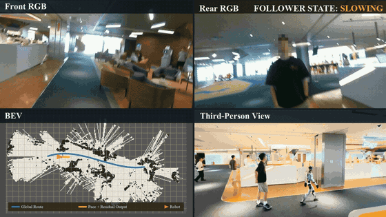
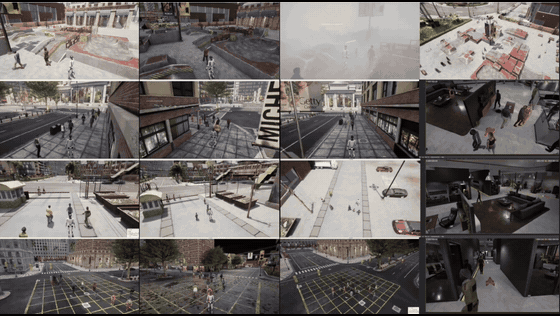
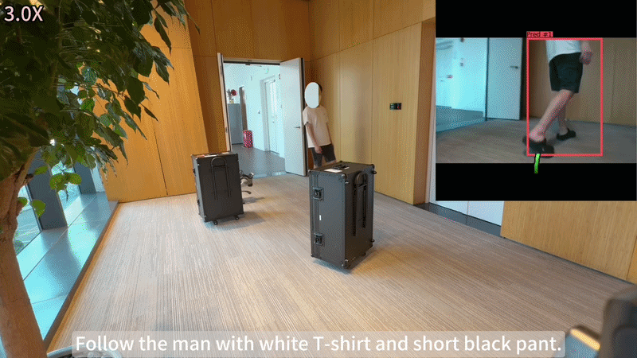
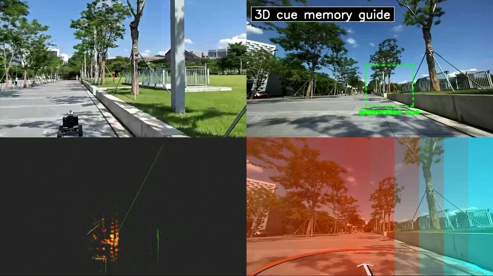
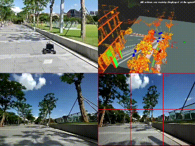

# 📝 Selected Projects
<!-- LeadVLA -->

<strong>LeadVLA: Learning Follower-Aware Route Execution for Robot Leading</strong>

<u>Tianle Zeng</u>, Hanjing Ye, Bingyi Xia, Yuchen Zhou, Zibo Zhang, Yufei Huang, Yonggen Ling, Hong Zhang

Under Review

[<a href="https://arxiv.org/abs/2611.30149">arXiv</a>] [<a href="https://louiszengcn.github.io/LeadVLA_PAGE/">project page</a>] [<a href="https://github.com/louiszengCN/LeadVLA_CODE">GitHub</a>]

<!-- Follow-Bench 2.0 -->

<strong>Follow-Bench 2.0: An End-to-End 3D Benchmark for Socially-Aware Robot Person Following</strong>

Hanjing Ye*, <u>Tianle Zeng</u>*, Jianwei Peng*, Yanci Wen, Yuchen Zhou, Yonggen Ling, Hong Zhang

* Equal contribution.

Conference on Neural Information Processing Systems (NeurIPS), 2026

[arXiv] [project page] [GitHub]

<!-- ReferTrack -->

<strong>ReferTrack: Referring Then Tracking for Embodied Visual Tracking</strong>

Hanjing Ye, <u>Tianle Zeng</u>, Jiazhao Zhang, Shaoan Wang, Zibo Zhang, Weixi Situ, Yuchen Zhou, Yonggen Ling, Hong Zhang

Under Review

[<a href="https://arxiv.org/abs/2607.20061">arXiv</a>] [<a href="https://www.youtube.com/watch?v=CP7h-tWWABU">video</a>] [<a href="https://medlartea.github.io/referTrack/">project page</a>] [<a href="https://github.com/MedlarTea/referTrack">GitHub</a>]

<!-- TARIC -->

<strong>TARIC: Memory-Augmented Traversability-Aware Outdoor VLN under Interrupted Semantic Cues</strong>

<u>Tianle Zeng</u>, Hanjing Ye, Jianwei Peng, Jingwen Yu, Hanxuan Chen, Hong Zhang

IEEE Robotics and Automation Letters (RA-L), 2026

[<a href="https://arxiv.org/abs/2605.31121">arXiv</a>] [<a href="https://www.youtube.com/watch?v=D8WeBlEGICc">video</a>]

<!-- EZREAL -->

<strong>EZREAL: Enhancing Zero-Shot Outdoor Robot Navigation toward Distant Targets under Varying Visibility</strong>

<u>Tianle Zeng</u>, Jianwei Peng, Hanjing Ye, Guangcheng Chen, Senzi Luo, Hong Zhang

IEEE International Conference on Robotics and Automation (ICRA), 2026

[<a href="https://arxiv.org/abs/2509.13720">arXiv</a>] [<a href="https://tianlezeng.github.io/EzReal/">project page</a>] [<a href="https://youtu.be/MTMmhOV20Wk">video</a>]

